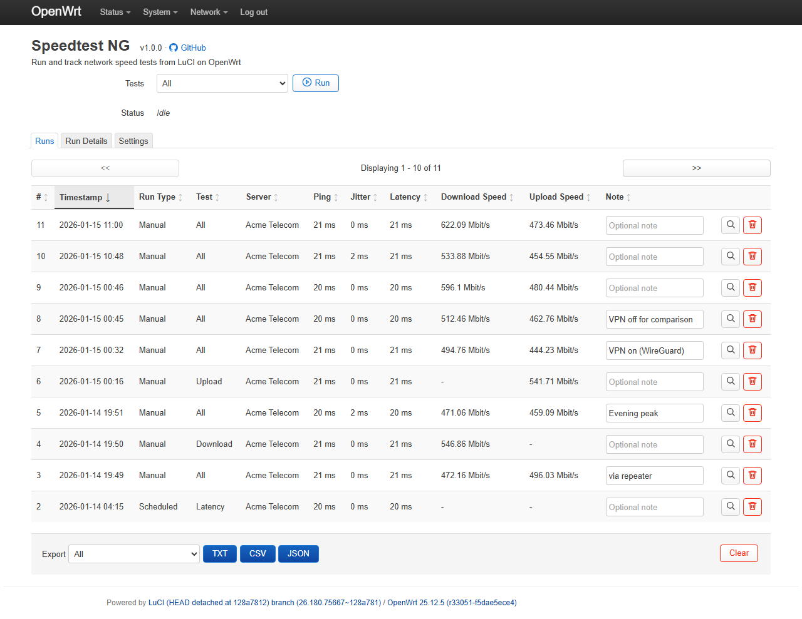
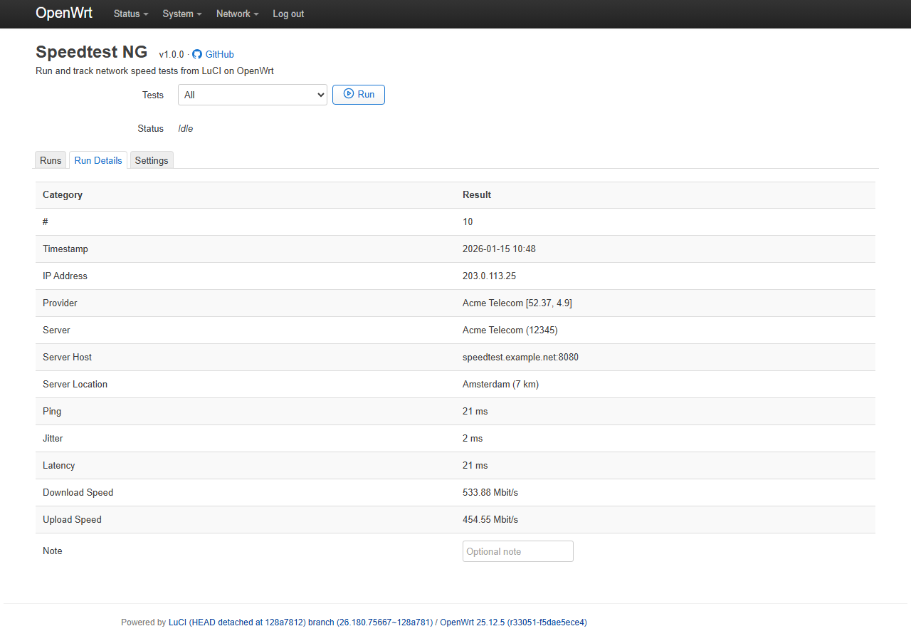
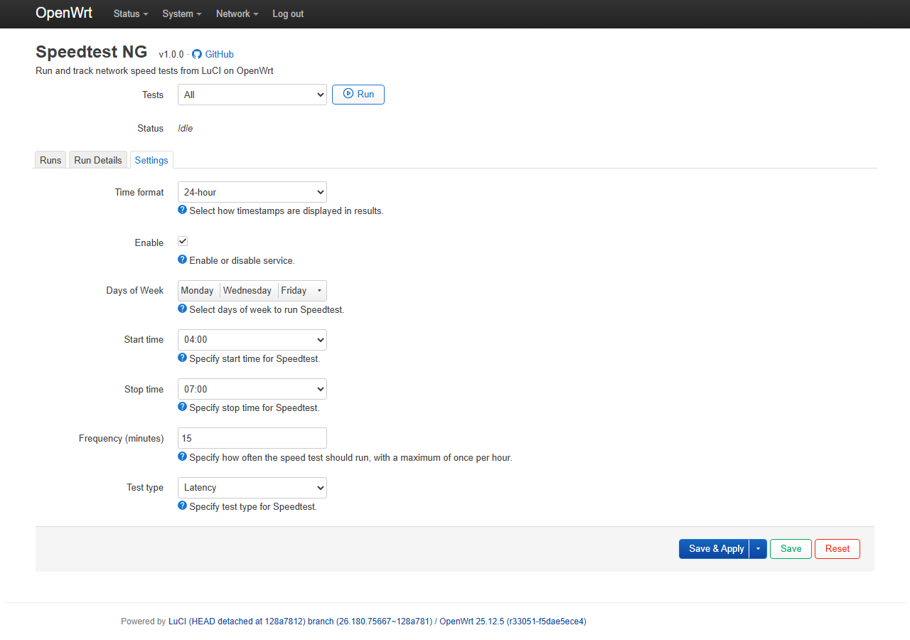

# luci-app-speedtest-ng

A LuCI web interface to run and track network speed tests on OpenWrt routers, built on `speedtestcpp`.

Inspired by [animegasan/luci-app-speedtest](https://github.com/animegasan/luci-app-speedtest), rewritten from the ground up with improved reliability, quality-of-life features, and support for both current OpenWrt package managers (`opkg` and `apk`).

## Quick Install

Auto-detects `opkg` / `apk` and installs the matching latest release package (`.ipk` or `.apk`):

```shell
wget -qO- https://raw.githubusercontent.com/vad-b/luci-app-speedtest-ng/main/install.sh | sh
```

After installation, navigate to **Network -> Speedtest NG** in the LuCI web interface.

Need manual package install options instead? See [Manual Installation](#manual-installation).

## Screenshots

<table>
  <tr>
    <td align="center" valign="top" width="33.33%">
      <b>Runs</b><br/>
      
    </td>
    <td align="center" valign="top" width="33.33%">
      <b>Run Details</b><br/>
      
    </td>
    <td align="center" valign="top" width="33.33%">
      <b>Settings</b><br/>
      
    </td>
  </tr>
</table>


## Features

- **Run tests** — All / Latency / Download / Upload, with live status.
- **Full per-run detail** — timestamp, client (IP / ISP / location), server (name / host / sponsor / distance), ping, jitter, latency, download and upload.
- **Run history** — a sortable table of every run to compare results at a glance, and open any run for its full details.
- **Editable notes** — annotate any run; saved automatically as you type.
- **Scheduling** — automatic tests via cron (days, time window, frequency, test type).
- **Export** — TXT, CSV or JSON, filtered by all / manual / scheduled runs.
- **Durable storage** — results are kept in a structured JSON store that survives reboots.
- **Lightweight** — built on `speedtestcpp` and `ucode`, no heavy dependencies.

## How it works

Speedtest NG is a LuCI front-end over the `speedtestcpp` CLI:

- the web UI launches tests and shows, sorts, annotates and exports the results;
- a small shell helper runs the test and owns the results file (a structured JSON store);
- cron triggers the scheduled tests.

## Manual Installation

### Install with `opkg` (`.ipk`)

Download the latest `.ipk` package from [Releases](https://github.com/vad-b/luci-app-speedtest-ng/releases), upload it to the router's `/tmp` directory, then:

```shell
opkg install /tmp/luci-app-speedtest-ng_*.ipk
```

### Install with `apk` (`.apk`)

Download the latest `.apk` package from [Releases](https://github.com/vad-b/luci-app-speedtest-ng/releases), upload it to the router's `/tmp` directory, then:

```shell
apk add --allow-untrusted --upgrade /tmp/luci-app-speedtest-ng-*.apk
```

## Development Tooling

- [Router SSH Tooling](.dev/router-ssh/README.md) — Configure router access, run commands, transfer files, and work in an open SSH session.
- [Deploy Files](.dev/deploy-files/README.md) — Push working-tree files to the router for testing without building a package.
- [Build Packages](.dev/build-packages/README.md) — Build `.apk` and `.ipk` packages locally using the same script as CI.
- [Capture Screenshots](.dev/capture-screenshots/README.md) — Capture LuCI pages with a consistent width and synthetic data.

## License

[GPL-3.0](LICENSE)
